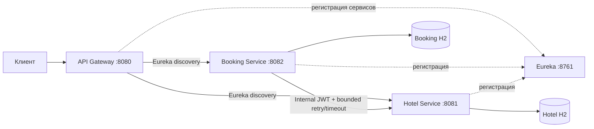

# Hotel Booking Microservices

Распределённое REST API для бронирования отелей. Проект состоит из API Gateway, Eureka Service Registry, Hotel Management Service и Booking Service. Каждый прикладной сервис использует собственную in-memory базу H2 и самостоятельно проверяет JWT.

## Быстрый запуск

Нужны Java 17+ и Maven 3.8+. В Replit стек запускается workflow **API Server**; локально из корня проекта:

```bash
./hotel-booking/scripts/dev-stack.sh
```

Шлюз будет доступен на `http://localhost:8080`, Eureka — на `http://localhost:8761`. Для остановки нажмите `Ctrl+C`. Данные H2 хранятся в памяти и очищаются после перезапуска приложений.

JWT-секрет передаётся через `JWT_SECRET` или `SESSION_SECRET`. Для локального запуска предусмотрено значение-заглушка; для любого постоянного окружения задайте длинный случайный секрет и не коммитьте его. Встроенные демо-пользователи:

| Роль | Логин | Пароль |
|---|---|---|
| ADMIN | `admin` | `Admin123!` |
| USER | `guest` | `Guest123!` |

Перед публикацией отключите демо-данные переменной `APP_SEED_ENABLED=false` и задайте безопасные значения через `APP_SEED_ADMIN_USERNAME` и `APP_SEED_ADMIN_PASSWORD`.

Отдельный запуск модулей:

```bash
mvn -f hotel-booking/pom.xml -pl discovery-server,hotel-service,booking-service,api-gateway -am package
```

## Архитектура



Сервис бронирования сначала фиксирует `PENDING` в своей локальной транзакции. Затем он запрашивает у Hotel Service блокировку дат; при успехе записывает `CONFIRMED`, а при ошибке переводит запись в `CANCELLED` и пытается освободить слот. Удалённый вызов ограничен тайм-аутом и тремя повторами с экспоненциальной задержкой; circuit breaker временно прекращает вызовы при серии сбоев. Внешняя распределённая транзакция не используется.

## API

Все пользовательские API проходят через Gateway. JWT передаётся заголовком `Authorization: Bearer <token>`. Токен действует один час. Для повторного запроса бронирования используйте один и тот же заголовок `Idempotency-Key`.

### Пользователи и бронирования

| Метод | Путь | Доступ | Назначение |
|---|---|---|---|
| `POST` | `/api/user/register` | без токена | Регистрация USER, выдача JWT |
| `POST` | `/api/user/auth` | без токена | Вход, выдача JWT |
| `GET` | `/api/user` | ADMIN | Список пользователей |
| `POST` | `/api/user` | ADMIN | Создать пользователя |
| `GET` | `/api/user/{id}` | ADMIN | Получить пользователя |
| `PATCH` | `/api/user/{id}` | ADMIN | Изменить логин, пароль или роль |
| `DELETE` | `/api/user/{id}` | ADMIN | Удалить пользователя |
| `POST` | `/api/booking` | USER/ADMIN | Создать бронь; `autoSelect: true` включает подбор |
| `GET` | `/api/bookings?page=0&size=20` | USER/ADMIN | Только личная история, с пагинацией |
| `GET` | `/api/booking/{id}` | USER/ADMIN | Получить свою бронь |
| `DELETE` | `/api/booking/{id}` | USER/ADMIN | Отменить бронь и освободить номер |

Пример:

```bash
TOKEN=$(curl -s http://localhost:8080/api/user/auth \
  -H 'Content-Type: application/json' \
  -d '{"username":"guest","password":"Guest123!"}' | jq -r .token)

curl -i http://localhost:8080/api/booking \
  -H "Authorization: Bearer $TOKEN" \
  -H 'Idempotency-Key: demo-booking-001' \
  -H 'Content-Type: application/json' \
  -d '{"autoSelect":true,"checkIn":"2027-02-10","checkOut":"2027-02-13"}'
```

При `autoSelect: true` поле `roomId` игнорируется. Подбор использует только свободные на запрошенные даты номера, сортирует по `timesBooked`, затем по ID. `available` означает операционную доступность (например, номер не закрыт на ремонт); занятость рассчитывается отдельно по датам.

### Отели и номера

| Метод | Путь | Доступ | Назначение |
|---|---|---|---|
| `GET` | `/api/hotels` | USER/ADMIN | Список отелей |
| `GET` | `/api/hotels/{id}` | USER/ADMIN | Отель |
| `POST` | `/api/hotels` | ADMIN | Создать отель |
| `PUT` | `/api/hotels/{id}` | ADMIN | Обновить отель |
| `DELETE` | `/api/hotels/{id}` | ADMIN | Удалить отель без номеров |
| `GET` | `/api/hotels/occupancy` | ADMIN | Статистика бронирований по отелям |
| `GET` | `/api/rooms` | USER/ADMIN | Доступные номера; даты и `hotelId` — необязательные фильтры |
| `GET` | `/api/rooms/recommend?checkIn=YYYY-MM-DD&checkOut=YYYY-MM-DD` | USER/ADMIN | Доступные номера в порядке автоподбора |
| `GET` | `/api/rooms/{id}` | USER/ADMIN | Номер |
| `POST` | `/api/rooms` | ADMIN | Создать номер |
| `PUT` | `/api/rooms/{id}` | ADMIN | Обновить номер |
| `DELETE` | `/api/rooms/{id}` | ADMIN | Удалить номер без активных броней |

Для `POST /api/rooms` используйте JSON вида `{"hotelId":1,"number":"301","available":true}`.

Внутренние `POST /api/rooms/{id}/confirm-availability` и `/release` доступны только с ролью `INTERNAL` и заблокированы на Gateway. Вызовы выполняются Booking Service напрямую через Eureka.

### OpenAPI

Спецификации доступны через общий Gateway:

- Booking Service: `/api/openapi/booking`
- Hotel Service: `/api/openapi/hotels`

При локальном запуске Swagger UI каждого сервиса также доступен по адресам `http://localhost:8082/swagger-ui.html` и `http://localhost:8081/swagger-ui.html`.
- Eureka: `http://localhost:8761`

## Согласованность и параллельные запросы

- `Idempotency-Key` уникален в Booking Service; повторный запрос с тем же ключом возвращает ранее созданную бронь.
- Неудавшееся освобождение записывается как ожидающая компенсация и автоматически повторяется фоновым заданием.
- Hotel Service использует `requestId` и блокировку строки номера (`PESSIMISTIC_WRITE`), проверяя пересечение интервалов как `[checkIn, checkOut)`.
- Параллельная попытка забронировать занятый слот получает `409 Conflict`.
- При компенсации Booking Service переводит бронь в `CANCELLED` и посылает `release`; события с `bookingId` логируются.
- Все gateway-запросы получают `X-Correlation-Id` (или используют значение клиента); этот заголовок передаётся дальше.

## Хранение данных

- Booking Service: `users`, `bookings`, индексы по владельцу/дате и комнате/датам.
- Hotel Service: `hotels`, `rooms`, `room_stays`, уникальные номера в пределах отеля, идемпотентные request ID.
- H2 — in-memory для учебного запуска; это не постоянное хранилище.

## Проверки и ADR

```bash
mvn -f hotel-booking/pom.xml test
mvn -f hotel-booking/pom.xml package
```

Тесты проверяют подбор по счётчику и ID, одновременную бронь пересекающихся дат, идемпотентный повтор, успешный шаг саги, компенсацию при сбое, диапазоны дат, выбор номера и ошибки авторизации/валидации через MockMvc.

### ADR 1 — сага вместо общей транзакции

Каждый сервис изменяет только собственную БД; Booking Service координирует шаги `PENDING → CONFIRMED` или `PENDING → CANCELLED` и компенсирует уже созданную блокировку. Это соответствует отсутствию общей транзакции между независимыми сервисами.

### ADR 2 — один ключ подписи для Resource Server

Gateway и сервисы валидируют один и тот же HMAC JWT с общим secret, но backend-сервисы не полагаются только на Gateway. Внутренние вызовы подписываются ролью `INTERNAL`, недоступной клиентской регистрации.

### ADR 3 — блокировка номера на время проверки

Hotel Service сериализует изменения по строке номера и проверяет пересечение дат в локальной транзакции. Это избегает гонок при выборе свободного номера без глобальных блокировок и без применения статистических моделей.
